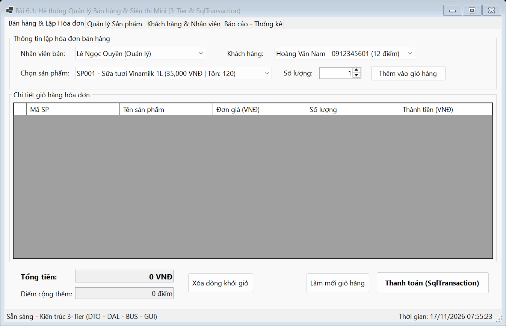
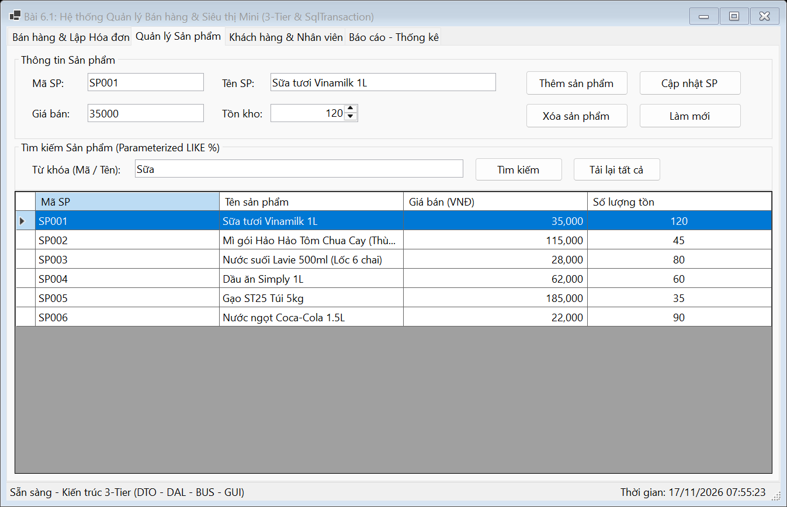
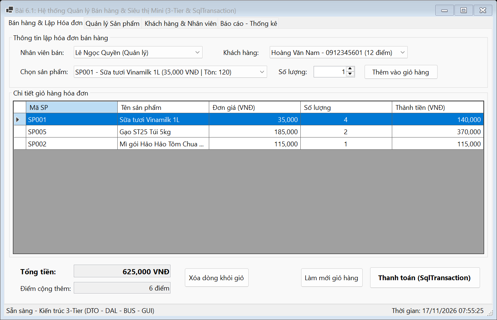
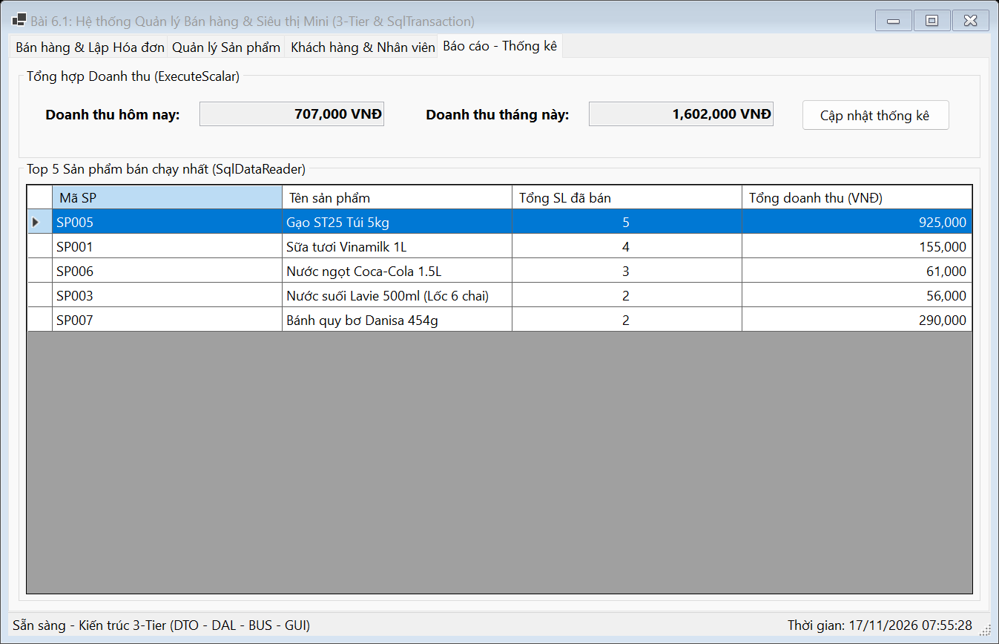
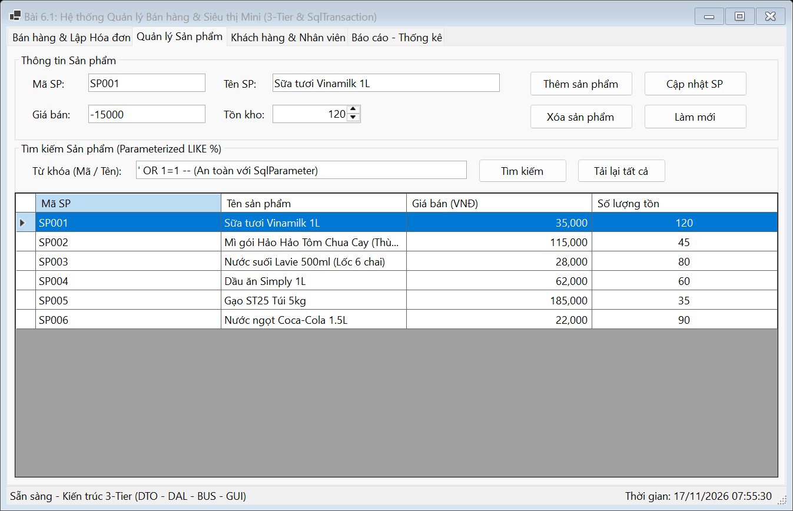

# BÀI 6.1: HỆ THỐNG QUẢN LÝ BÁN HÀNG & SIÊU THỊ MINI (RETAIL SALES SYSTEM)

## MỤC 1: THÔNG TIN SINH VIÊN
- **Họ và tên sinh viên:** Lê Ngọc Quyền
- **Mã sinh viên:** 24810310259
- **Lớp / Khóa:** D19CNPM3
- **Môn học:** Lập trình .NET / Windows Forms (ADO.NET & Kiến trúc 3-Tier)

---

## MÔ TẢ KIẾN TRÚC & TÍNH NĂNG
- **Kiến trúc chuẩn 3-Tier:** `DTO` $\rightarrow$ `DAL` $\rightarrow$ `BUS` $\rightarrow$ `GUI`.
- **Cơ sở dữ liệu SQL Server (`SalesDB`):** Gồm 5 bảng có quan hệ khóa ngoại: `NhanVien`, `KhachHang`, `SanPham`, `HoaDon`, `ChiTietHoaDon` (xem file [`Database/ScriptDB.sql`](./Database/ScriptDB.sql)).
- **An toàn dữ liệu:** Sử dụng 100% `SqlParameter` chống SQL Injection (kể cả tìm kiếm `LIKE %`).
- **Giao dịch ACID (`SqlTransaction`):** Khi bấm *Thanh toán*, hệ thống mở Transaction thực hiện đồng thời chèn `HoaDon`, chèn `ChiTietHoaDon`, trừ `SoLuongTon` (tự động `Rollback()` nếu tồn kho không đủ) và cộng `DiemTichLuy = TongTien / 100,000` cho khách hàng.
- **Báo cáo - Thống kê:** Dùng `ExecuteScalar` tính tổng doanh thu ngày/tháng và `SqlDataReader` lấy Top 5 sản phẩm bán chạy nhất.

---

## MỤC 2: HÌNH ẢNH KẾT QUẢ CÁC MÀN HÌNH CHỨC NĂNG

### 1. Màn hình Chính / Tổng quan hệ thống

### 2. Màn hình Quản lý Danh mục (CRUD - Thêm/Sửa/Xóa & Tìm kiếm)

### 3. Màn hình Thực thi Nghiệp vụ chính (Lập Hóa đơn / Bán hàng với SqlTransaction)

### 4. Màn hình Báo cáo - Thống kê (ExecuteScalar & SqlDataReader Top 5)

### 5. Minh họa An toàn Dữ liệu (Phòng chống SQL Injection / Kiểm tra hợp lệ)

