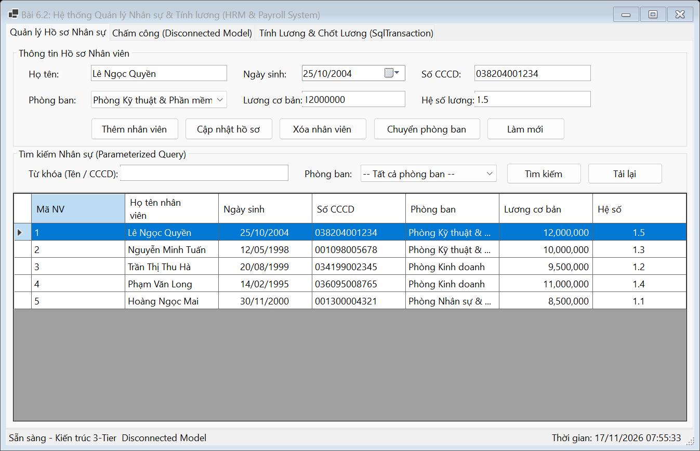
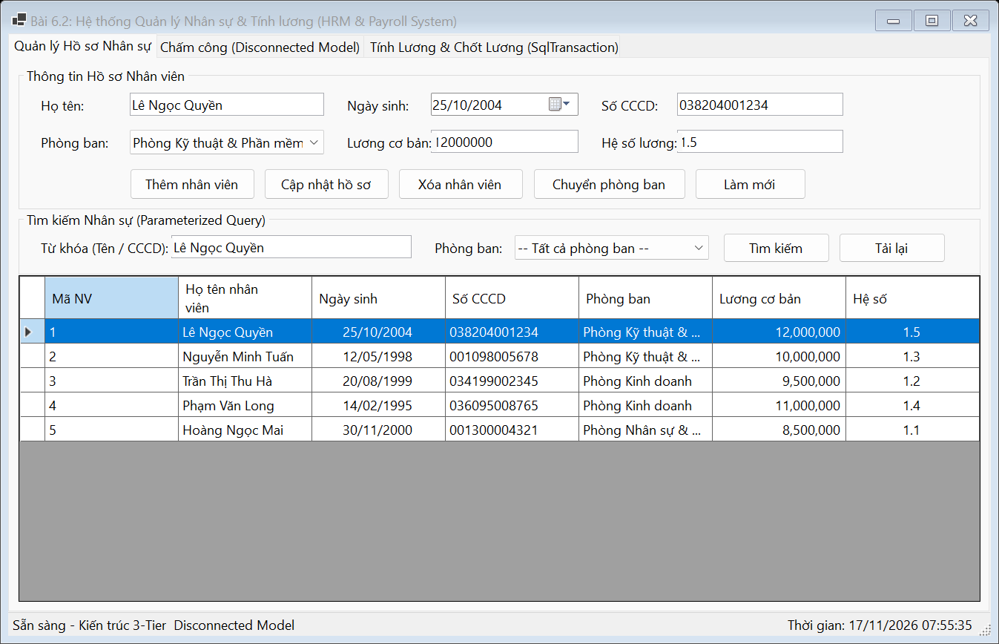
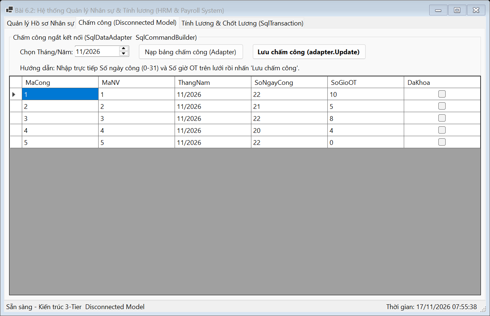
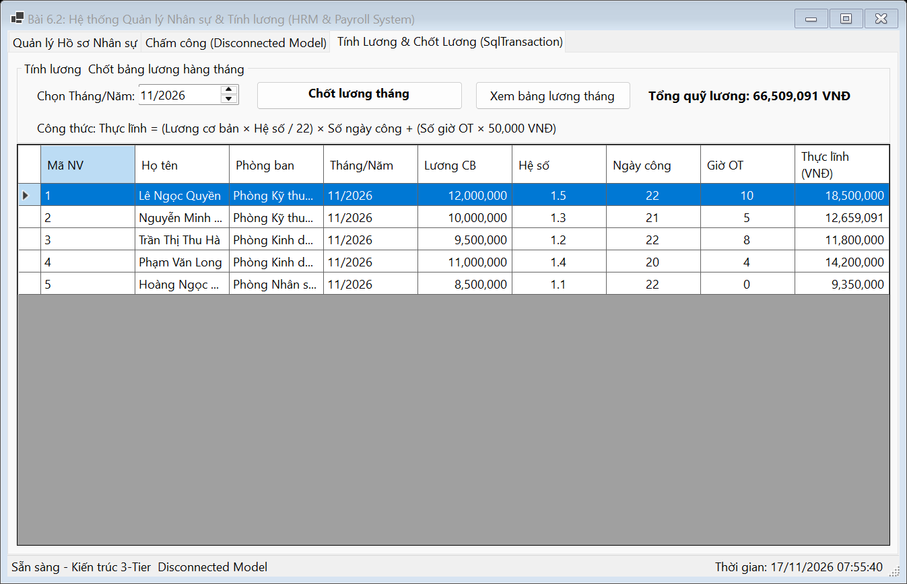
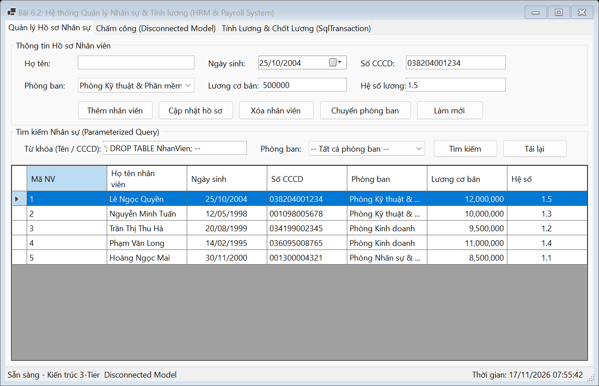

# BÀI 6.2: HỆ THỐNG QUẢN LÝ NHÂN SỰ & TÍNH LƯƠNG (HRM & PAYROLL SYSTEM)

## MỤC 1: THÔNG TIN SINH VIÊN
- **Họ và tên sinh viên:** Lê Ngọc Quyền
- **Mã sinh viên:** 24810310259
- **Lớp / Khóa:** D19CNPM3
- **Môn học:** Lập trình .NET / Windows Forms (ADO.NET, Disconnected Model & Kiến trúc 3-Tier)

---

## MÔ TẢ KIẾN TRÚC & TÍNH NĂNG
- **Kiến trúc chuẩn 3-Tier:** `DTO` $\rightarrow$ `DAL` $\rightarrow$ `BUS` $\rightarrow$ `GUI`.
- **Cơ sở dữ liệu SQL Server (`HRMDB`):** Gồm 4 bảng chính: `PhongBan`, `NhanVien`, `BangChamCong`, `BangLuong` (xem file [`Database/ScriptDB.sql`](./Database/ScriptDB.sql)).
- **Quản lý Hồ sơ Nhân sự (CRUD & Tìm kiếm):** Thêm, sửa, xóa, chuyển phòng ban và tìm kiếm theo tên, phòng ban hoặc CCCD bằng `SqlParameter`.
- **Chấm công ngắt kết nối (Disconnected Model):** Sử dụng `SqlDataAdapter` nạp toàn bộ bảng chấm công tháng vào `DataTable`, nhập trực tiếp số ngày công và giờ OT trên `DataGridView`, bấm *Lưu chấm công* sử dụng `SqlCommandBuilder` và `adapter.Update()` đồng bộ về SQL Server trong 1 thao tác.
- **Tính lương & Chốt lương (`SqlTransaction`):** Áp dụng công thức `ThucLinh = (LuongCoBan * HeSoLuong / 22) * SoNgayCong + (SoGioOT * 50,000)`, mở Transaction ghi nhận `BangLuong` và khóa dữ liệu chấm công (`DaKhoa = 1`).

---

## MỤC 2: HÌNH ẢNH KẾT QUẢ CÁC MÀN HÌNH CHỨC NĂNG

### 1. Màn hình Chính / Tổng quan hệ thống

### 2. Màn hình Quản lý Danh mục (CRUD Hồ sơ Nhân sự - Thêm/Sửa/Xóa/Tìm kiếm)

### 3. Màn hình Thực thi Nghiệp vụ chính (Chấm công ngắt kết nối - SqlDataAdapter)

### 4. Màn hình Báo cáo - Thống kê (Bảng lương & Chốt lương SqlTransaction)

### 5. Minh họa An toàn Dữ liệu (Phòng chống SQL Injection / Kiểm tra lỗi đầu vào)

